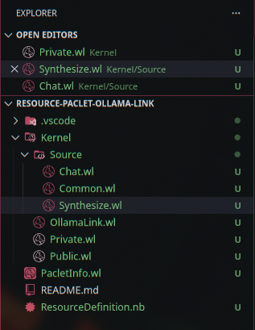
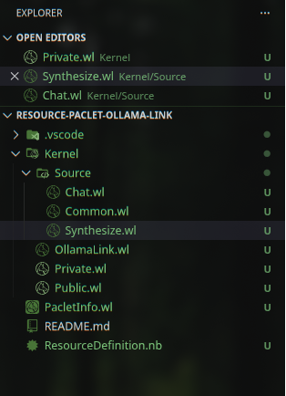
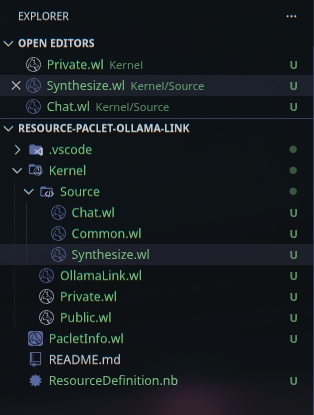
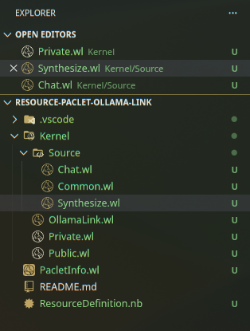

# Adapt Icons

**A dynamic VS Code icon theme that automatically matches your system's accent color.**

Adapt Icons takes a comprehensive set of 2,400+ file and folder icons and converts them to a cohesive monochrome palette derived from your OS accent color. Every icon updates in real time when your system theme changes — no manual configuration needed.

## Screenshots

|  |  |
|---|---|
|  |  |
|  |  |

## Features

- **System accent detection** — Automatically reads your accent color from KDE Plasma, GNOME, macOS, and Windows
- **Real-time updates** — Icons refresh when you change your system accent color
- **2,400+ icons** — Covers 1,700+ file types and 330+ folder types with dedicated open/closed states
- **Dark mode variants** — Select icons ship with dark variants for better visibility
- **Custom color override** — Set any hex color manually if you prefer

## Installation

1. Open the **Extensions** view in VS Code (`Ctrl+Shift+X`)
2. Search for **Adapt Icons**
3. Click **Install**
4. Go to **File > Preferences > File Icon Theme** and select **Adapt Icons**

## Usage

Once activated, Adapt Icons detects your system accent color and generates all icons automatically. There is nothing else to configure.

### Commands

Open the Command Palette (`Ctrl+Shift+P`) and type:

| Command | Description |
|---------|-------------|
| `Adapt Icons: Refresh from System Accent` | Manually re-detect your system accent color and regenerate icons |
| `Adapt Icons: Set Custom Accent Color` | Override the system color with a custom hex value (e.g. `#3daee9`) |
| `Adapt Icons: Debug Info` | Show diagnostic information about the current state |

### Settings

| Setting | Default | Description |
|---------|---------|-------------|
| `adaptIcons.accentColor` | `""` (empty) | Custom accent color in hex. Leave empty to auto-detect from your system. |

## Supported Platforms

| Platform | Detection Method |
|----------|-----------------|
| **KDE Plasma** | `kreadconfig5` / `kreadconfig6` + file watcher |
| **GNOME** | `gsettings` accent color preference |
| **GTK** | `gtk-3.0` / `gtk-4.0` CSS parsing |
| **macOS** | `AppleAccentColor` from system defaults |
| **Windows** | DWM accent color from the Windows Registry |

If detection fails or your DE is unsupported, the extension falls back to a default blue (`#5B9BD5`). You can always set a custom color manually.

## How It Works

Adapt Icons uses a luminance-based color mapping algorithm to convert the source icon set into your accent color palette:

1. Source SVGs use a predefined set of neutral gray tones at different luminance levels
2. On activation, the extension detects your system accent color
3. Each icon's fill and stroke colors are remapped to accent-derived tones that preserve the original visual depth
4. The generated icons are written to disk and VS Code's icon theme is updated

Icons are cached and only regenerated when the accent color actually changes.

## License

[MIT](LICENSE.md) &copy; Antonis Aristeidou
